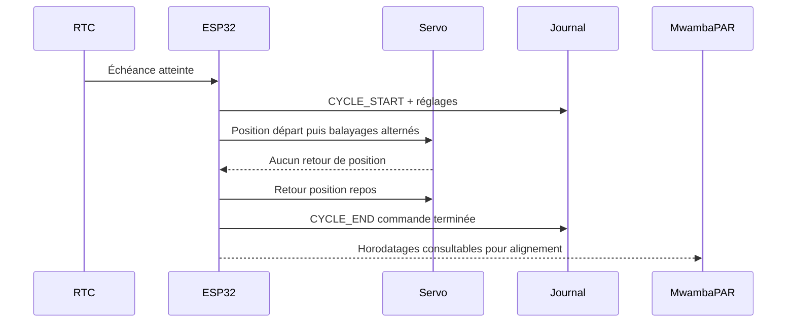

# Séquences MwambaWiper et synchronisation des mesures

## 1. Vocabulaire de commande

- **Cycle de nettoyage :** une séquence déclenchée automatiquement ou manuellement.
- **Passage (coup) :** un balayage complet d’une extrémité de la zone optique à l’autre. Le premier déplacement vers l’extrémité de départ et le retour au repos ne sont pas comptés.
- **Intervalle :** temps entre deux démarrages automatiques de cycles.
- **Délai entre passages :** pause programmable entre deux balayages.
- **Stabilisation :** délai après le brossage avant de reprendre une mesure exploitable.

Cette convention de comptage est la proposition de départ ; elle devra être confirmée avec la cinématique et le sens donné à « un coup ».

## 2. Cycle autonome

1. Au démarrage, l’ESP32 initialise le RTC, charge les réglages et monte LittleFS.
2. Si l’horloge est valide, il restaure la prochaine échéance ou la programme à partir de l’heure courante.
3. À l’échéance, il journalise le départ, place le servo sur l’extrémité de départ puis réalise le nombre demandé de passages alternés.
4. Il ramène le bras à la position de repos, journalise la fin de séquence commandée et programme l’échéance suivante.
5. Une commande manuelle est acceptée uniquement si aucun cycle n’est en cours ; elle ne déplace pas l’échéance périodique.
6. Si le RTC est absent/invalide, les cycles automatiques sont suspendus ; l’essuyage manuel reste possible et les événements sont signalés comme non horodatés.

Le servo trois fils ne fournit pas de confirmation de position. « Terminé » dans le journal signifie que les ordres et temporisations prévus ont été exécutés, pas que la brosse a effectivement parcouru sa course.

## 3. Séquence scientifique recommandée

Pour un essai de caractérisation de l’effet du nettoyage :

1. Acquérir une période **avant brossage** sans essuyage, avec les capteurs optiques dans leur état courant.
2. Journaliser le début du cycle et relever les données brutes pendant le brossage si l’équipement de mesure continue à fonctionner.
3. Maintenir une période de **stabilisation** après le retour au repos. Ne pas effacer ces valeurs.
4. Reprendre une période **après brossage** de même durée que la période avant brossage.
5. Aligner les fichiers par horodatage RTC ; annoter la fenêtre de brossage et la fenêtre de stabilisation dans l’analyse.
6. Comparer les niveaux, la variabilité et la dérive avant/après. Répéter avec une durée d’encrassement contrôlée.

Au premier prototype, MwambaWiper et MwambaPAR sont deux appareils distincts : la synchronisation se fait par horloges RTC et alignement des journaux. Une ligne de déclenchement entre appareils ou une communication dédiée est une évolution ultérieure, à définir avec le connecteur et le protocole de mesure retenus.

## 4. Journal CSV

Le firmware crée `/events.csv` dans LittleFS. Les événements comportent :

`timestamp_local,uptime_ms,event,stroke,target_us,stroke_count,interval_min,detail`

Événements prévus : `BOOT`, `CYCLE_START`, `POSITION_START`, `STROKE_CMD`, `PARK_CMD`, `CYCLE_END`, `CYCLE_ABORT`, `RTC_ERROR`, `CONFIG_UPDATE`, `MANUAL_REQUEST`.

L’heure est celle programmée dans le RTC (Mayotte, UTC+3 dans la configuration de terrain). La ligne `CYCLE_END` représente une séquence commandée ; elle ne certifie pas le mouvement physique. Les données brutes ne sont pas supprimées par le nettoyage.

## 5. Qualification avant et après déploiement

La fenêtre optique doit être inspectée et le capteur caractérisé avant déploiement, puis contrôlé après récupération. Les fichiers bruts restent conservés. Comparer les mesures de référence, les périodes avant/après brossage et l’état de la surface afin de distinguer effet de biofilm, effet du nettoyage et dérive instrumentale. Les cycles doivent être journalisés avec leurs paramètres et leur statut de commande ; l’absence de retour de position doit rester visible dans l’analyse.

Cette démarche suit les limites décrites dans la [revue anti-biofouling](REVUE_ANTIFOULING.md), sans présumer que l’essuyage suffira à prévenir tout dépôt.

## 6. Paramètres à valider au banc

- Définition opérationnelle d’un passage et nombre de passages utile.
- Position de repos qui ne masque pas le capteur.
- Impulsions PWM min/max compatibles avec la course mécanique réelle.
- Durée de déplacement et délai entre passages.
- Intervalle de nettoyage selon la vitesse de dépôt/biofouling.
- Durée de stabilisation avant exploitation des mesures.
- Effet de la brosse sur le signal optique, le hublot et le diffuseur.
