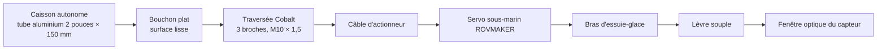
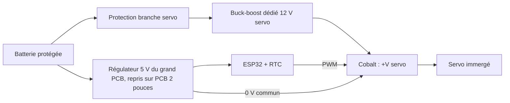

# Schéma mécanique conceptuel

> Schéma d’architecture, non coté et non prêt à fabriquer. Les interfaces du servo, de la tête optique, du bouchon et du DG-Core doivent être mesurées avant CAO.

## Vue fonctionnelle



## Implantation proposée

### Caisson de commande

- Tube aluminium de 2 pouces et 150 mm de long, construit autour du DG-Core.
- ESP32, RTC, support batterie, convertisseurs et protections maintenus sur un support interne démontable.
- Le Cobalt bulkhead se monte sur un bouchon ou une platine plane avec un perçage nominal de 10 mm ; son joint torique doit porter sur une surface extérieure lisse.
- LED et interrupteur existants à identifier : voyant d’état et commande logique, ou simple coupure générale. Le firmware ne leur attribue pas encore de fonction.
- Garder une séparation physique entre la distribution de puissance du servo et les signaux/logique ; réunir les masses au point prévu par le schéma électrique.

### Tête optique et essuie-glace

- Fixer le servo au plus près de la fenêtre optique, avec son axe parallèle à la surface à balayer.
- Le bras doit couvrir la zone active sans heurter le bord du hublot ni toucher le diffuseur/capteur.
- Prévoir une position de repos hors de la zone optiquement utile si la géométrie le permet.
- Employer une lèvre/brosse remplaçable, compatible avec le matériau du hublot ; comparer douceur, efficacité et usure, puis inspecter le hublot après des cycles répétés.
- Garder le mécanisme démontable pour remplacer la pièce d’usure sans remplacer le servo.
- Laisser des jeux et chemins d’évacuation qui tolèrent les particules et dépôts ; le macrofouling peut bloquer un essuie-glace.
- Limiter mécaniquement la course pour que le servo ne force jamais sur une butée. La consigne PWM ne doit pas servir de butée mécanique.
- Ajouter une protection contre le desserrage du bras et l’accrochage par câble ou débris.
- Le servo trois fils ne confirme pas son déplacement ; un suivi du courant ou un retour de position peut être étudié si les essais révèlent des blocages, sans le présenter comme une fonction du premier prototype.

## Vue de face indicative

```text
       zone utile du hublot
     ┌─────────────────────┐
     │   ↘                 │
     │     ↘ bras          │  ← balayage alterné
     │       ●──────────    │
     │       axe            │
     │  (position repos à   │
     │   définir hors zone) │
     └─────────────────────┘
```

## Schéma électrique de principe



Pour le modèle 15 kg suspecté, ROVMAKER indique 12–28 V, 50 Hz PWM et 0,2–0,6 A ; confirmer ces valeurs pour la référence exacte et mesurer le courant sous charge. Un pack 3S fait 11,1 V nominaux et 12,6 V lorsqu’il est chargé : il faut un buck-boost 12 V régulé si la plage minimale de 12 V est confirmée. Le régulateur 5 V repris du grand PCB alimente la logique. Le servo ne doit pas être alimenté depuis cette sortie 5 V. Le retour de masse logique et servo doit être commun pour référencer le PWM ; la distribution de puissance reste séparée et protégée.

## Interface Cobalt / caisson

Le bulkhead Cobalt est annoncé avec filetage M10 × 1,5 et montage dans un trou de 10 mm. Le choix recommandé pour le servo est une version 3 broches : alimentation, masse et PWM. Le servo reçu pèse 213 g et semble correspondre au modèle ROVMAKER 15 kg·cm. Le fabricant indique pour ce modèle 12–28 V et 0,2–0,6 A, à confirmer sur la référence exacte et en charge. Une traversée 3 broches standard devrait donc suffire électriquement ; la version **3-pin Power** reste une option si elle simplifie le choix du câble. Confirmer le brochage avant câblage.

L’inox 316 du connecteur et l’aluminium du caisson forment un assemblage de métaux différents en milieu marin. Prévoir une protection anticorrosion et une isolation adaptée sans altérer la portée du joint torique.

## Implantation batterie et énergie

Le pack 3S envisagé (3 000 ou 5 000 mAh) doit être vérifié physiquement avec le diamètre intérieur réel du tube et le DG-Core. Réserver un chemin de câbles et un accès au connecteur d’équilibrage/charge conformément au mode d’usage retenu. Ne pas placer le pack contre le convertisseur servo s’il chauffe en fonctionnement.

## Référence de conception

La [revue des stratégies anti-biofouling](../docs/REVUE_ANTIFOULING.md) justifie ces choix de conception : protéger l’optique contre l’abrasion, faciliter le remplacement de la pièce d’usure, éviter le blocage par particules, et limiter les risques d’étanchéité/corrosion aux interfaces immergées.

## Cotes à relever pour passer en CAO

1. Référence exacte du tube, diamètre intérieur, diamètre extérieur et épaisseur.
2. Type de bouchon, épaisseur et profondeur disponible pour le corps du bulkhead et l’écrou.
3. Position/diamètre des autres pénétrateurs, LED et interrupteur.
4. Carte ESP32, dimensions batterie, connecteurs et volume du support DG-Core.
5. Dimensions de la fenêtre optique, zone active, diffuseur et obstacles.
6. Référence et plan coté du servo, axe de sortie, palonnier et points de fixation.
7. Longueur de câble, orientation du connecteur et position de repos souhaitée.
